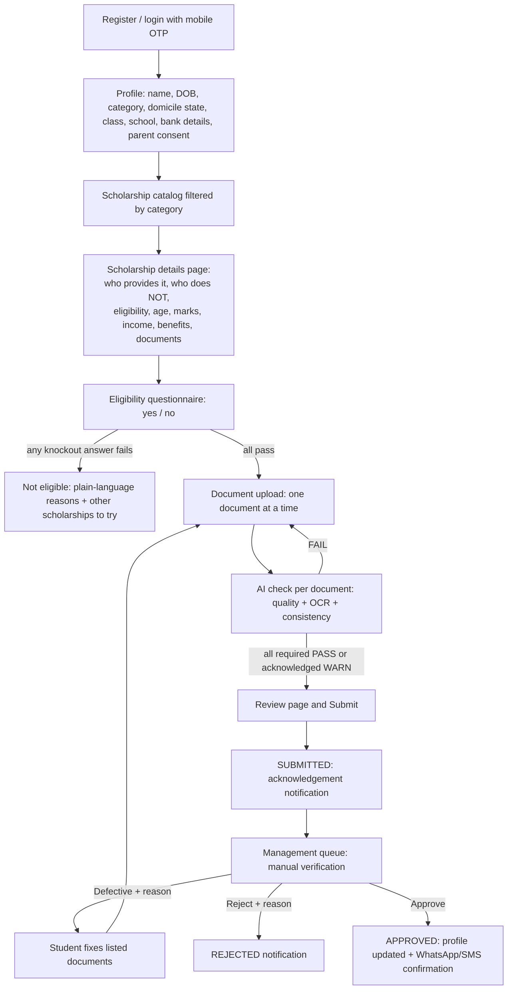

# Workflow, State Machine and Data Model

Scope of this file: the complete student-to-management workflow for the first scholarship (Pre-Matric, ST, Classes IX-X). Everything is driven by `scholarship.pre-matric-st.json`, so other scholarships (ST-only or open to all) work by adding another config file.

---

## 1. Actors

| Actor | What they do |
|---|---|
| Student | Registers, browses scholarships, answers the eligibility questions, uploads documents, submits, tracks status. Class IX-X students are minors, so a parent/guardian consent step is required. |
| Management reviewer | Manually verifies every submitted application. Approves, marks defective, or rejects. |
| Admin | Manages scholarship configs (upload JSON), users, audit log. |
| System / AI | Document quality check, OCR, cross-document consistency check, notifications. It never makes the final decision. |

## 2. Category gating (ST-only vs open to all)

Each scholarship has `categoryRule.mode`:

- `ST_ONLY`: only students whose profile category is ST.
- `OPEN_TO_ALL`: any category.
- `ALLOWED_LIST`: only listed categories.

Rules:
1. The catalog shows a student: scholarships they are allowed to apply to first, and the others in a separate "Not for your category" section with the reason. (Transparent, not hidden.)
2. The category rule is enforced again on the server when an application is created. The questionnaire's ST question is a second, independent check.
3. Category comes from the student's profile, and the ST certificate (when relevant) is what management verifies manually.

## 3. End-to-end flow



## 4. Step by step

### Step 0. Details page (before any question)
Show, in one clear format, from the JSON:
1. Name, status, academic year.
2. **Who is giving it:** `provider` (ministry, who implements it, funding split, how money reaches the student).
3. **Who is NOT giving it:** `notProviders` (so students do not confuse NSP, schools, other ministries).
4. **Eligibility:** category rule, class/education, **maximum age and minimum marks** (show "No age limit" / "No minimum marks" when null, and say a State may add its own rule), family income limit, how income is counted, bank/other-scholarship/repeat rules.
5. **Benefits:** day scholar vs hosteller amounts, books grant, disability allowance.
6. **Documents needed** (marking which are conditional).
7. Buttons: "Check my eligibility".

### Step 1. Eligibility questionnaire
- One yes/no question per screen, big Yes / No buttons, progress bar, Hindi/English toggle.
- Apply `skipIf` logic (orphan skips income question; renewal question only if previously awarded).
- Result: ELIGIBLE or INELIGIBLE with a reason per failed question and links to other scholarships.
- Store every answer with timestamp. The questionnaire is *self-declaration*; management verifies later.
- Also ask profile questions (hostel? disability?) because they change benefits and required documents.

### Step 2. Document upload (one by one)
- Show a checklist of required documents from the JSON (apply `requiredIf` / `requiredUnless`).
- Student uploads one document at a time (camera or gallery). Show the student tip for that document.
- Next document unlocks only after the current one is uploaded (the student may skip ahead and return).

### Step 3. AI verification (immediate)
- Runs automatically after each upload, results in under ~10 seconds where possible, with a loading state.
- Output per document: `PASS`, `WARN` (with reason), or `FAIL` (with reason and "Retake" button).
- Then cross-document checks run (name, father's name, state, DOB, bank holder).
- **Submit button stays disabled** until every required document has PASS, or WARN that the student explicitly acknowledged. Any FAIL blocks.
- AI is a helper: it checks readability and consistency. It cannot say a certificate is genuine.

### Step 4. Manual verification (management)
- Submission creates a queue item. Reviewer opens a split view: document viewer on the left, extracted data vs student-entered data, AI flags, and the checklist on the right.
- The reviewer must open every document and tick every checklist item before **Approve** is enabled.
- **Mark Defective** (student can fix) and **Reject** (final) need a written reason.
- Every action is written to an audit log.

### Step 5. Approval and notification
- On Approve: application status becomes APPROVED, student profile gets the scholarship in "My scholarships", and a WhatsApp message (SMS fallback) goes to the registered number.
- Also notify on submit, defective and reject. Always show the same message inside the student's account.
- "Approved" here means verified and submitted by management inside this platform. Real NSP/State portal submission and payment are out of scope for the first draft.

## 5. Application state machine

| State | Meaning | Next states |
|---|---|---|
| DRAFT | Application created | ELIGIBILITY_FAILED, DOCS_IN_PROGRESS |
| ELIGIBILITY_FAILED | A knockout answer failed | DRAFT (if the student re-answers) |
| DOCS_IN_PROGRESS | Eligible, uploading | READY_TO_SUBMIT |
| READY_TO_SUBMIT | All required docs PASS or acknowledged WARN | SUBMITTED |
| SUBMITTED | Waiting for management | UNDER_REVIEW |
| UNDER_REVIEW | A reviewer opened it | APPROVED, DEFECTIVE, REJECTED |
| DEFECTIVE | Sent back with reasons | DOCS_IN_PROGRESS |
| APPROVED | Verified | (end of this draft) |
| REJECTED | Final for this cycle | (end) |

Allow only these transitions and reject anything else on the server.

## 6. Data model (Prisma-style, simplified)

```
Student        id, fullName, fatherName, dob, gender, mobile (unique, verified), email?,
               socialCategory (ST|SC|OBC|GENERAL|EWS|OTHER), domicileState, district,
               language (en|hi), currentClass, schoolName, isHosteller,
               aadhaarLast4, bankAccountEnc, ifsc, bankName, bankHolderName,
               guardianConsentAt, createdAt

Scholarship    id (slug), configJson, status, academicYear, version, createdAt

Application    id (human id e.g. SCH-2026-000123), studentId, scholarshipId,
               type (fresh|renewal), status, eligibilityResult, benefitRate,
               submittedAt, decidedAt, decidedBy, decisionReason

EligibilityAnswer  id, applicationId, questionId, answer (yes|no), answeredAt

Document       id, applicationId, docTypeId, storagePath, mime, sizeBytes, version,
               uploadedAt, replacedById?

AiCheck        id, documentId, status (PASS|WARN|FAIL), qualityJson, ocrText, extractedJson,
               confidence, messages (student-facing), flags (reviewer-facing), createdAt

CrossCheck     id, applicationId, checkId, status, detailJson, createdAt

Review         id, applicationId, reviewerId, level, checklistJson, action
               (approve|mark_defective|reject), reason, createdAt

Notification   id, studentId, applicationId, event, channel (whatsapp|sms|in_app),
               payload, status (queued|sent|failed|delivered), providerMessageId, createdAt

User           id, email, passwordHash, role (admin|management_reviewer|district_state_officer)

AuditLog       id, actorType, actorId, action, entity, entityId, metaJson, ip, createdAt
```

Notes:
- Never store the full Aadhaar number. Store `aadhaarLast4` only.
- Encrypt bank account number at rest; show masked (`XXXXXX1234`).
- Keep every uploaded version of a document; never overwrite silently.

## 7. Permissions

| Action | Student | Reviewer | Admin |
|---|---|---|---|
| View own application and documents | yes | no | no |
| View any application and documents | no | yes (logged) | yes (logged) |
| Approve / defective / reject | no | yes | no |
| Upload / edit scholarship JSON | no | no | yes |
| View audit log | no | no | yes |

## 8. Edge cases to handle

- Student changes the category answer after failing: re-run the questionnaire, keep history.
- Same mobile number registered twice: block, ask to log in.
- Same document uploaded for two different slots (e.g. Aadhaar as ST certificate): AI should WARN.
- Student closes the app mid-upload: everything saved as draft, resume where they left.
- Photo taken of a screen or a photocopy of a photocopy: WARN for quality.
- Document in Hindi or a regional language: OCR with `eng+hin`; if confidence is low, WARN and send to manual review (do not FAIL on language alone).
- Notification fails: retry (WhatsApp then SMS), keep the in-app message, show failure to admin.
- Scholarship config updated while applications are open: applications keep the config `version` they started with.
- Low internet: compress images client-side before upload; show upload progress; allow retry.
